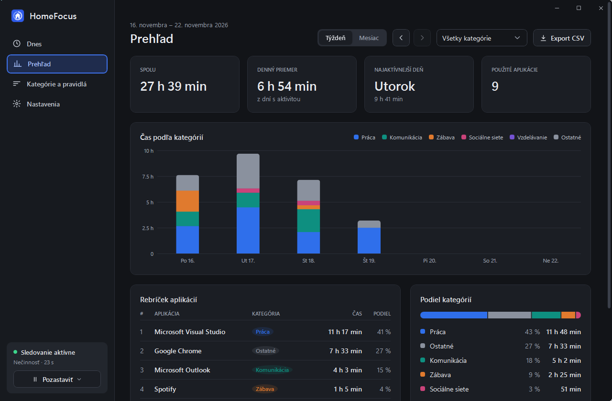

<p align="center"></p>

<h1 align="center">HomeFocus</h1>

<p align="center">
  <a href="https://github.com/mejmo/HomeFocus/actions/workflows/ci.yml"></a>
  <a href="https://github.com/mejmo/HomeFocus/actions/workflows/release.yml"></a>
  
  
  
  
</p>

<p align="center">Desktopová aplikácia pre Windows, ktorá automaticky sleduje, koľko času trávite v jednotlivých aplikáciách. Všetky dáta ostávajú v počítači a do cloudu sa nič neposiela.</p>



- **Sledovanie** aktívneho okna každú sekundu, s rozpoznaním nečinnosti (prah sa dá nastaviť), pauzy a uspania PC
- **Dashboard**: časová os dňa, top aplikácie, kategórie, týždenný a mesačný prehľad, export do CSV
- **Kategórie a pravidlá**: automatické zaradenie podľa procesu (`devenv.exe`, `steam*.exe`). Vlastné pravidlá platia aj pre už zaznamenanú históriu.
- **Systray**: rýchly prehľad dňa, pauza, autostart pri prihlásení
- Svetlý aj tmavý vzhľad podľa Windows

Dáta: `%APPDATA%\HomeFocus\data.db` (SQLite).

## Inštalácia

Stiahnite si `HomeFocus-Setup-x.y.z.exe` z [Releases](../../releases). Inštalátor nepotrebuje administrátorské práva a aplikáciu nainštaluje do `%LOCALAPPDATA%\Programs\HomeFocus`. .NET netreba inštalovať samostatne, je súčasťou aplikácie. Pri odinštalovaní dáta v `%APPDATA%\HomeFocus` ostanú.

## Vývoj

Potrebné je .NET 9 SDK a Windows 10 alebo novší.

```powershell
dotnet build
dotnet test
dotnet run --project src/HomeFocus.App
```

Premenná `HOMEFOCUS_DB` presmeruje aplikáciu na inú databázu, napríklad na skúšanie. Debug build nikdy nezapisuje autostart do registrov.

| Priečinok | Obsah |
|---|---|
| `src/HomeFocus.Core` | databáza, pravidlá, sledovanie (Win32), reporty |
| `src/HomeFocus.App` | WPF UI: `Themes/` (vlastné štýly), `Views/`, `ViewModels/`, `Controls/` (grafy) |
| `tests/HomeFocus.Tests` | xUnit testy jadra |
| `installer/HomeFocus.iss` | inštalátor (Inno Setup 6) |
