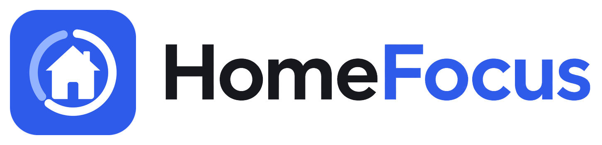
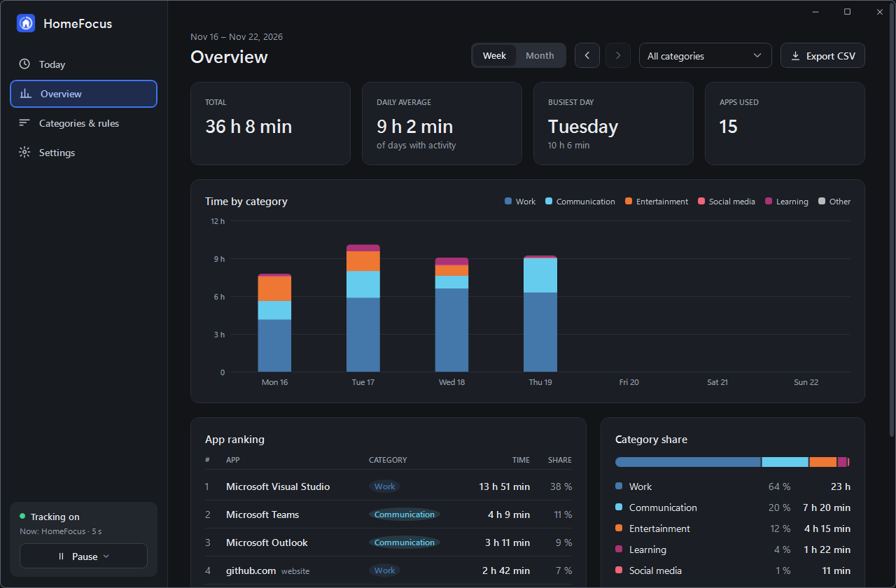

<p align="center">
  <picture>
    <source media="(prefers-color-scheme: dark)" srcset="docs/images/logo-dark.png">
    
  </picture>
</p>

<p align="center">
  <a href="https://github.com/mejmo/HomeFocus/actions/workflows/ci.yml"></a>
  <a href="https://github.com/mejmo/HomeFocus/actions/workflows/release.yml"></a>
  
  
  
  
</p>

<p align="center"><b>Stay in focus while you work from home.</b><br>
HomeFocus quietly tracks where your time goes on your Windows PC, so you can see when work turns into scrolling.</p>



## Why HomeFocus

Working from home blurs the line between work and everything else. HomeFocus shows you, honestly and without judgement, how your day really went: how much was deep work, how much was chat, and when the breaks got long.

It is **fully self-hosted**. Everything runs and stays on your own computer, and **nothing is ever sent to the cloud**: no account, no telemetry, no server, no internet connection at all. The only connection is a local one on `127.0.0.1` for the optional browser extension. Your history lives in a single local file you own.

## Features

- **Automatic tracking** of the active app, once a second, with idle detection (adjustable), pause and sleep handling
- **Dashboard**: day timeline, top apps, categories, weekly and monthly overview, CSV export
- **Categories & rules**: apps are sorted by process name (`devenv.exe`, `steam*.exe`); your own rules also apply to past history
- **Websites**: the HomeFocus browser extension (Chrome, Edge and other Chromium browsers) reports the domain of your active tab, so browser time is split per website. It talks only to the app on `127.0.0.1`; private windows are never reported.
- **Tray icon**: today at a glance, pause, starts quietly with Windows
- Light and dark theme following Windows; English and Slovak UI

Data: `%LOCALAPPDATA%\HomeFocus\data.db` (SQLite).

## Install

Download `HomeFocus-Setup-x.y.z.exe` from [Releases](../../releases). The installer is signed, needs no admin rights and installs to `%LOCALAPPDATA%\Programs\HomeFocus`; .NET is bundled. HomeFocus then starts with Windows straight into the tray. Uninstalling keeps your data in `%LOCALAPPDATA%\HomeFocus`.

## Development

Requires the .NET 9 SDK on Windows 10 or later.

```powershell
dotnet build
dotnet test
dotnet run --project src/HomeFocus.App
```

In Debug builds `HOMEFOCUS_DB` points the app at another database; `HOMEFOCUS_LANG=en|sk` forces the UI language. Debug builds never write the autostart entry.

| Folder | Contents |
|---|---|
| `src/HomeFocus.Core` | database, rules, tracking (Win32), reports |
| `src/HomeFocus.App` | WPF UI: `Themes/` (custom styles), `Views/`, `ViewModels/`, `Controls/` (charts), `Localization/` |
| `tests/HomeFocus.Tests` | xUnit tests for the core |
| `extension/` | browser extension (Manifest V3). Load it unpacked from `chrome://extensions` for development |
| `installer/` | Inno Setup installer |
