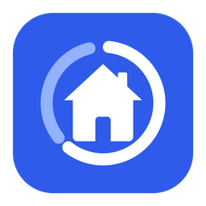

<p align="center"></p>

# HomeFocus

HomeFocus je desktopová aplikácia pre Windows, ktorá automaticky sleduje, koľko času trávite v jednotlivých aplikáciách. Všetky dáta ostávajú v počítači a do cloudu sa nič neposiela.

- **Sledovanie** aktívneho okna každú sekundu, s rozpoznaním nečinnosti (prah sa dá nastaviť), pauzy a uspania PC
- **Dashboard**: časová os dňa, top aplikácie, kategórie, týždenný a mesačný prehľad, export do CSV
- **Kategórie a pravidlá**: automatické zaradenie podľa procesu (`devenv.exe`, `steam*.exe`). Vlastné pravidlá platia aj pre už zaznamenanú históriu.
- **Systray**: rýchly prehľad dňa, pauza, autostart pri prihlásení
- Svetlý aj tmavý vzhľad podľa Windows

Dáta: `%APPDATA%\HomeFocus\data.db` (SQLite).

## Inštalácia

Stiahnite si `HomeFocus-Setup-x.y.z.exe` z [Releases](../../releases). Inštalátor nepotrebuje administrátorské práva a aplikáciu nainštaluje do `%LOCALAPPDATA%\Programs\HomeFocus`. .NET netreba inštalovať samostatne, je súčasťou aplikácie. Pri odinštalovaní dáta v `%APPDATA%\HomeFocus` ostanú.

## Vývoj

Potrebné je .NET 9 SDK a Windows 10 alebo novší.

```powershell
dotnet build
dotnet test
dotnet run --project src/HomeFocus.App
```

Premenná `HOMEFOCUS_DB` presmeruje aplikáciu na inú databázu, napríklad na skúšanie. Debug build nikdy nezapisuje autostart do registrov.

| Priečinok | Obsah |
|---|---|
| `src/HomeFocus.Core` | databáza, pravidlá, sledovanie (Win32), reporty |
| `src/HomeFocus.App` | WPF UI: `Themes/` (vlastné štýly), `Views/`, `ViewModels/`, `Controls/` (grafy) |
| `tests/HomeFocus.Tests` | xUnit testy jadra |
| `installer/HomeFocus.iss` | inštalátor (Inno Setup 6) |

## CI/CD

- **CI** (`.github/workflows/ci.yml`): build a testy pri každom pushi do `main` a pri každom pull requeste.
- **Release** (`.github/workflows/release.yml`): tag `v1.2.3` spustí testy, self-contained publish, podpis `HomeFocus.exe`, build inštalátora, podpis inštalátora a nakoniec vytvorí GitHub Release.

  ```powershell
  git tag v0.1.0
  git push origin v0.1.0
  ```

  Bez nastaveného podpisu tagovaný release zlyhá. Ručné spustenie workflowu (*Run workflow*) vytvorí nepodpísaný inštalátor ako artefakt.

## Podpisovanie (Azure Artifact Signing)

Release sa podpisuje existujúcim účtom **Azure Artifact Signing** (ten istý, ktorý používa sf-querynator). Workflow potrebuje:

| Typ | Názov | Hodnota |
|---|---|---|
| secret | `AZURE_TENANT_ID` | Directory (tenant) ID app registrácie |
| secret | `AZURE_CLIENT_ID` | Application (client) ID |
| secret | `AZURE_CLIENT_SECRET` | client secret (Value) |
| variable | `AZURE_SIGNING_ENDPOINT` | Account URI, napr. `https://eus.codesigning.azure.net/` |
| variable | `AZURE_SIGNING_ACCOUNT` | názov signing accountu |
| variable | `AZURE_SIGNING_PROFILE` | názov certificate profile |
| variable | `AZURE_SIGNING_PUBLISHER` | CN certifikátu, použije sa ako vydavateľ v inštalátore |

App registrácia musí mať na signing accounte rolu **Artifact Signing Certificate Profile Signer**. Secrets nastavíte cez `gh secret set <NÁZOV>` alebo v *Settings → Secrets and variables → Actions*. Client secret má obmedzenú platnosť, preto ho pred vypršaním obnovte v Entra ID a aktualizujte aj tu.
